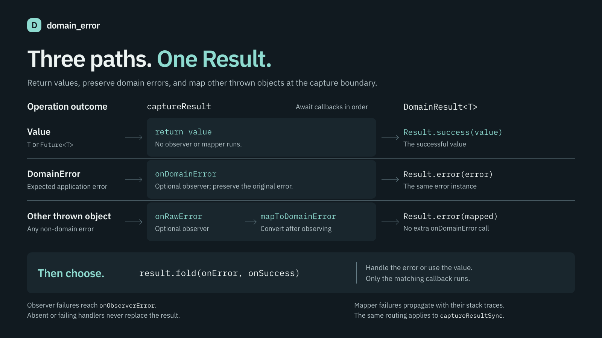
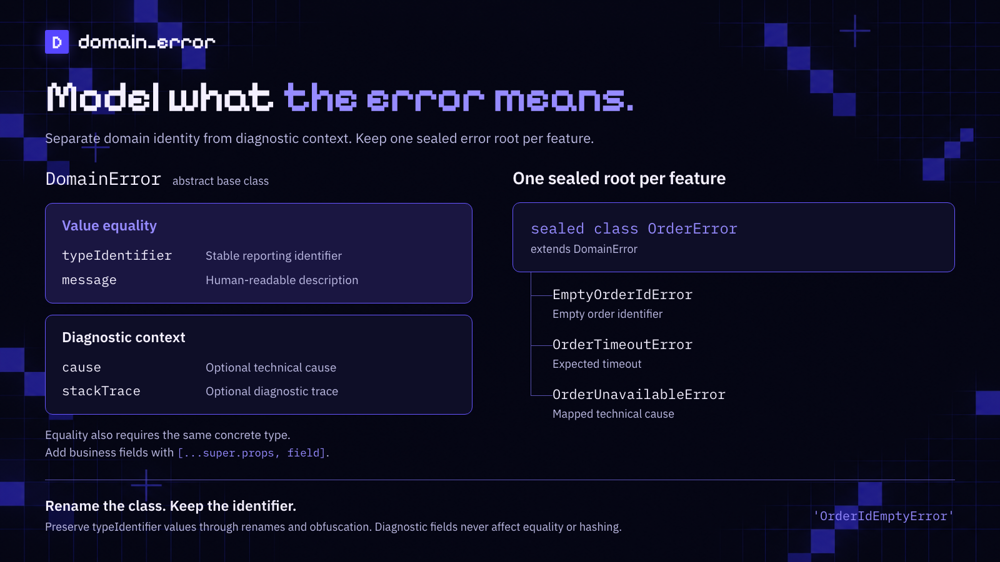
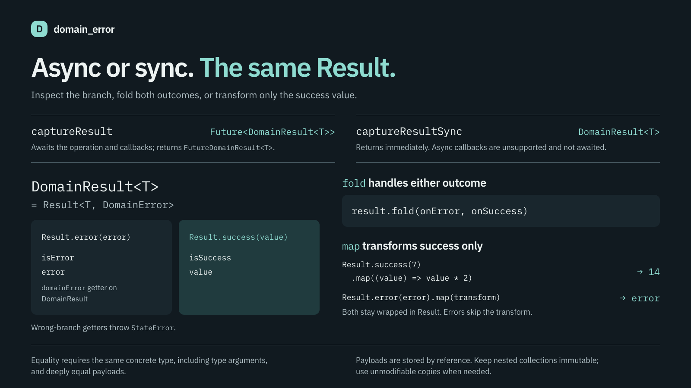

# domain_error



Turn thrown errors into values you can fold.

A `DomainError` represents an expected domain or application error.
`Result<T>` is `Either<DomainError, T>`; `FutureResult<T>` is `Future<Result<T>>`.
Use `captureResult` for asynchronous work and `captureResultSync` for synchronous work.

## Install

```yaml
dependencies:
  domain_error: ^4.0.0
```

Requires Dart 3.0.0 or later within Dart 3. The package is pure Dart and has no
Flutter SDK dependency. A separate consumer checks Flutter 3.10.0 and current stable
without dependency overrides.

## Model errors



Keep one sealed error root per feature. Set `typeIdentifier` explicitly and
preserve its value when renaming classes. It remains readable after obfuscation.

```dart
import 'package:domain_error/domain_error.dart';

sealed class OrderError extends DomainError {
  const OrderError({super.message, super.cause, super.stackTrace});
}

final class EmptyOrderIdError extends OrderError {
  const EmptyOrderIdError();

  // Preserve the existing identifier after the class rename.
  @override
  String get typeIdentifier => 'OrderIdEmptyError';
}

final class OrderUnavailableError extends OrderError {
  const OrderUnavailableError({super.cause, super.stackTrace});

  @override
  String get typeIdentifier => 'OrderUnavailableError';
}
```

Errors compare by their concrete type, `typeIdentifier`, and `message`.
Diagnostic `cause` and `stackTrace` do not participate in equality or hashing.
Subclasses can include business fields in `props`:

```dart
final class OrderRejectedError extends OrderError {
  final String reason;

  const OrderRejectedError(this.reason, {super.message, super.cause, super.stackTrace});

  @override
  String get typeIdentifier => 'OrderRejectedError';

  @override
  List<Object?> get props => [...super.props, reason];
}
```

`toString()` uses the identifier and the first non-empty description source:
`message`, then `cause`. It trims whitespace and takes the first line, recognizing
LF, CRLF, and CR. A nested `DomainError` contributes its identifier. An empty,
opaque, or throwing cause description becomes `unknown`. Without a message or
cause, only the identifier is returned. The full fields remain available.

## Capture and fold



```dart
final result = await captureResult<Order>(
  () => loadOrder(id: id),
  mapToDomainError: (rawError, stackTrace) {
    return OrderUnavailableError(cause: rawError, stackTrace: stackTrace);
  },
  onDomainError: (domainError, stackTrace) {
    print('${domainError.typeIdentifier}: $stackTrace');
  },
  onRawError: (rawError, stackTrace) {
    print('$rawError: $stackTrace');
  },
  onObserverError: (observerError, stackTrace) {
    print('Observer failed: $observerError: $stackTrace');
  },
);

result.fold(
  (domainError) => print(domainError.typeIdentifier),
  (successValue) => print(successValue.title),
);

final syncResult = captureResultSync<Order>(
  () => loadOrder(id: id),
  mapToDomainError: (rawError, stackTrace) {
    return OrderUnavailableError(cause: rawError, stackTrace: stackTrace);
  },
);
```

Runnable sample, including `Order`, `loadOrder`, and timeout mapping:
[`example/domain_error_example.dart`](example/domain_error_example.dart).

The handling order is explicit:

1. A successful operation returns `Either.success`; no callbacks run.
2. A thrown `DomainError` triggers `onDomainError`, then returns `Either.error`
   containing the same error object.
3. Any other thrown object triggers `onRawError`, then `mapToDomainError`.
   The mapped error is returned without triggering `onDomainError` again.
4. An observer failure triggers `onObserverError` with that failure and its trace.
   Without the handler, the observer failure is ignored. Failures of the handler
   itself are also ignored without recursion, preserving the operation result.
5. Mapper failures propagate unchanged with their stack traces. They are not
   observer failures and do not become a fallback `DomainError`.

`captureResult` awaits the operation, observers, observer error handler, and mapper.
`captureResultSync` requires a synchronous mapper and observers. All three
observers return `Null`, so async functions and `void` tear-offs are rejected by
type checking. Wrap a synchronous `void` function in a block returning null.
Use `captureResult` when observation is asynchronous.

The synchronous operation stores its returned `T` unchanged. If `T` is a
`Future`, the result contains that future without awaiting it or capturing its
later errors. Use `captureResult` to capture asynchronous completion.

## Work with Either

`Either<L, R>` also supports error values that are not `DomainError` instances.

```dart
const success = Either<String, int>.success(7);
const error = Either<String, int>.error('missing');

final doubled = success.map((value) => value * 2);
assert(doubled.successValue == 14);
assert(error.isError);
assert(success.isSuccess);
assert(error.errorValue == 'missing');
```

`map` transforms only the success value. It preserves the error payload without
calling the transform. Accessing the wrong branch getter throws `StateError`;
use `fold` or pattern matching to handle both branches. `domainError` is available
only on `Result<T>` and also throws on a successful result. Nullable payloads
remain valid values of their respective branches.

Equality requires the same concrete result type, including both type arguments
and the branch, plus deeply equal payloads. Equality is checked in both directions.
The hash includes the result type and the deep payload hash.

### Compose operations

`andThen` runs a result-returning operation on success. `mapError` transforms
only an error. `recover` handles only an error and returns another result with
the same error and success types, allowing a selected fallback or an unchanged
error. Skipped callbacks never run; steps run once, in order.

```dart
final result = await captureResult<int>(
  () async => 20,
  mapToDomainError: (error, trace) => OrderUnavailableError(cause: error, stackTrace: trace),
)
    .andThen((value) async => Either.success(value + 1))
    .map((value) => value * 2)
    .mapError((error) => error)
    .recover((error) => const Either.success(-1));

assert(result.successValue == 42);
```

On an existing `Either`, use `mapAsync`, `andThenAsync`, `mapErrorAsync`, or
`recoverAsync` to await a callback. On `Future<Either<L, R>>`, the corresponding
unsuffixed methods await both the source and the selected `FutureOr` callback.
Finish with `fold` after the final `await`.

Composition preserves nullable payloads and unchanged payload references.
Exceptions thrown by transforms or recovery functions propagate with their
original objects and stack traces. A failed source future also propagates;
`recover` handles an error payload, not a failed future. Capture a throwing
operation explicitly when it should become a domain error.

### Keep payloads immutable

`Either` stores its payload by reference and does not copy it. A mutable payload
can change equality and hashing, making an existing map key or set element
unfindable. Keep nested collections immutable too. Take explicit snapshots with
standard collections when necessary:

```dart
final source = <String, List<int>>{'items': [1, 2]};
final snapshot = Map<String, List<int>>.unmodifiable({
  for (final entry in source.entries)
    entry.key: List<int>.unmodifiable(entry.value),
});
final result = Either<String, Map<String, List<int>>>.success(snapshot);
final results = {result};

source['items']!.add(3);
assert(result.successValue['items']!.length == 2);
assert(results.contains(result));
```

Copy every mutable layer you own. An unmodifiable outer collection alone does
not protect mutable elements or nested collections.

## Migrate from 3.x to 4.0.0

Move the fields of `CaptureResultOptions` and `CaptureResultSyncOptions` directly
to named function arguments. Both Options classes are removed without aliases.
Sync observers now return `Null`; wrap existing synchronous `void` functions
and use the async API for asynchronous observers.

See the [complete migration guide](https://github.com/andrey-krasheninnikov/domain_error/blob/main/docs/migration-4.0.md)
and the runnable [migration example](example/migration_v4.dart). The public
import, domain error identity, SDK minimums, and existing result names remain.

## Migrate from 2.x to 3.0.0

Version 3.0.0 removes the previous names without compatibility aliases.
The package name and public import `package:domain_error/domain_error.dart` stay the same.

| Previous API | Version 3.0.0 |
| --- | --- |
| `Either.err` / `Either.ok` | `Either.error` / `Either.success` |
| `EitherErr` / `EitherOk` | `EitherError` / `EitherSuccess` |
| `isErr` / `isOk` | `isError` / `isSuccess` |
| `errValue` | `errorValue` |
| `DomainError.rawError`, including constructor arguments | `DomainError.cause` |
| `executeSafely` / `executeSafelySync` | `captureResult` / `captureResultSync` |
| `ExecuteSafelyOptions` / `ExecuteSafelySyncOptions` | `CaptureResultOptions` / `CaptureResultSyncOptions` |
| `mapRawErrorToDomain` | `mapToDomainError` |
| Positional parameter `method` | `operation` |
| `fold` parameters `ifErr` / `ifOk` | `onError` / `onSuccess` |

Update subclass forwarding parameters to `super.cause`. Keep the existing
`typeIdentifier` strings even when a class name changes. Positional parameter
renames do not change call syntax.

Review behavior changes as well as names: observer failures no longer escape,
`onObserverError` is optional, diagnostics no longer affect `DomainError` equality,
and different concrete generic result types compare unequal in both directions.
String descriptions now consistently use one line and tolerate failing causes.
Applications that need observer diagnostics should supply `onObserverError`.

`DomainError`, `Either`, `Result`, `FutureResult`, `domainError`, `successValue`,
`fold`, `map`, `typeIdentifier`, `message`, `stackTrace`, `onDomainError`, and
`onRawError` retain their names.

## Project documentation

- [Domain glossary](GLOSSARY.md)
- [Architecture decisions](https://github.com/andrey-krasheninnikov/domain_error/tree/main/docs/adr)
- [Repository guidance](AGENTS.md)
- Workflow configuration: [issue tracker](https://github.com/andrey-krasheninnikov/domain_error/blob/main/docs/agents/issue-tracker.md),
  [triage labels](https://github.com/andrey-krasheninnikov/domain_error/blob/main/docs/agents/triage-labels.md), and
  [domain documentation](https://github.com/andrey-krasheninnikov/domain_error/blob/main/docs/agents/domain.md).

## Development

From a repository checkout, run `make deps`, then `make check`. The check target does not rewrite source files.
Use `make format` to apply formatting and `make publish-dry-run` to validate the package.
Formatting uses the Dart 3.0 language style and a line length of 120, set by the
Makefile so the same commands work on minimum and current SDKs.

CI checks Dart 3.0.0 and current stable on pull requests and pushes to `main`.
Flutter consumer jobs check Flutter 3.10.0 and current stable independently of the
library checks. With the selected Flutter SDK on `PATH`, run `make flutter-deps`,
then `make flutter-check`; use `make flutter-format` to format the fixture.

To check the lowest runtime dependencies, run `flutter pub downgrade` inside
`tool/flutter_consumer`, then run `make flutter-check` from the repository root.
Flutter 3.10.0 pins collection 1.17.1 and meta 1.9.1; downgrade also selects
equatable 2.0.7. The library test runner has its own development dependencies and
does not constrain this consumer resolution.

Editable diagrams live in `assets/overview.html`, `assets/flow.html`, and
`assets/fold.html`, with shared `assets/readme-art.css`. Run `make diagrams` to
render the three 1600×900 PNGs with headless Chrome. Set `CHROME_BIN` to override
the Chrome or Chromium executable. All diagram resources are local.
The bundled IBM Plex fonts use the [SIL Open Font License](assets/fonts/OFL.txt).

## License

MIT. Issues: https://github.com/pchkauu/domain_error/issues
